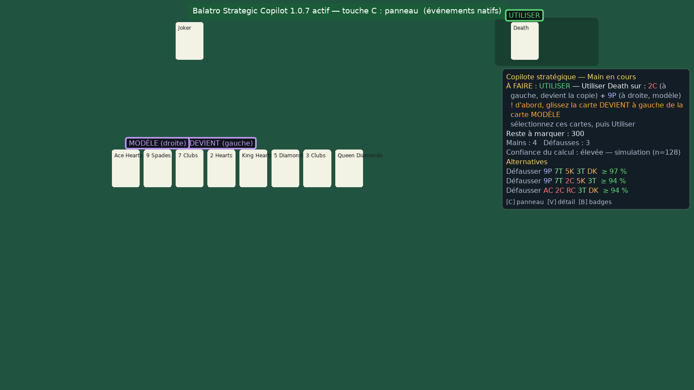
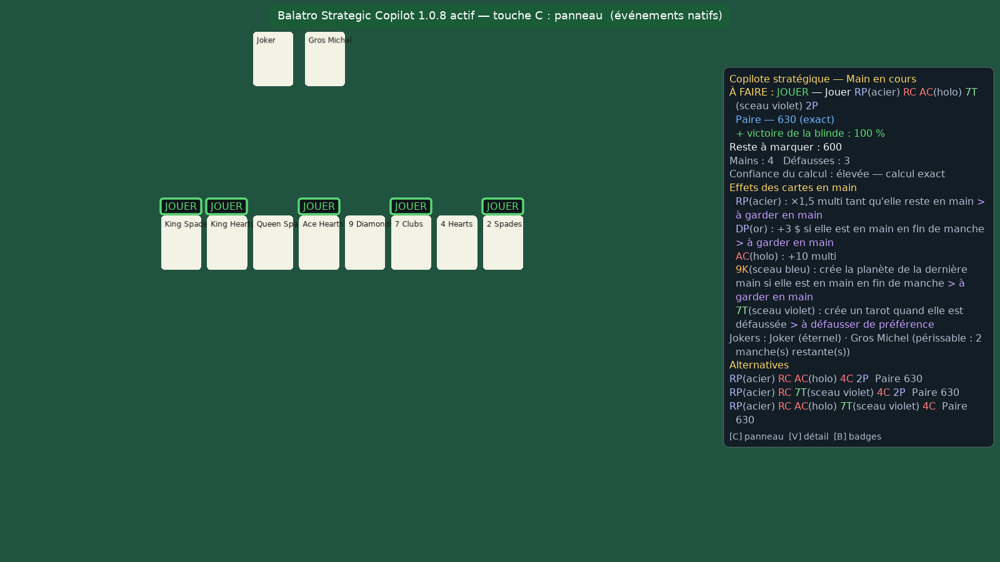
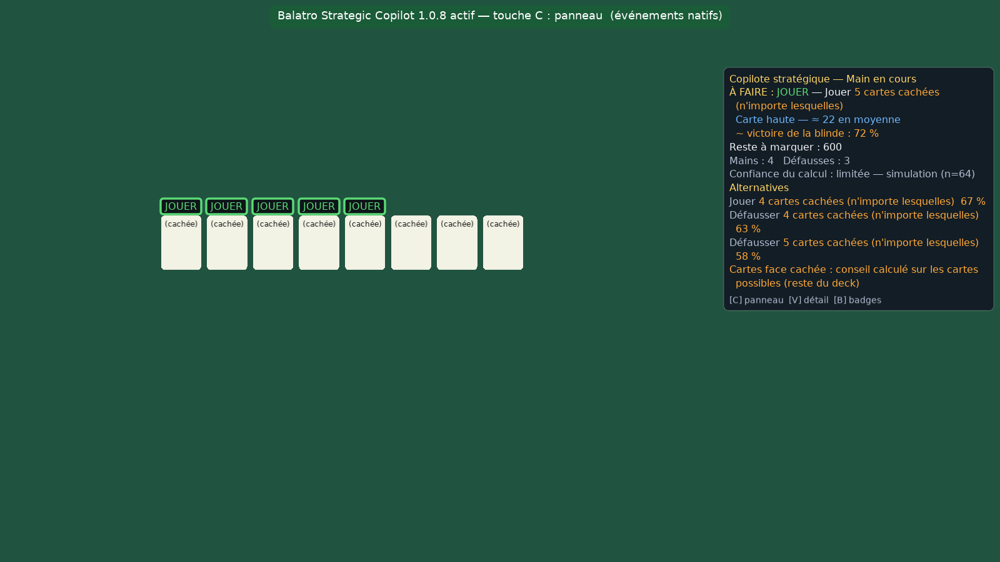
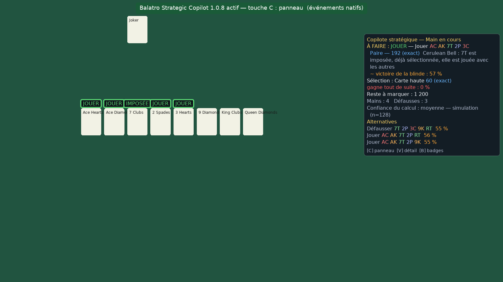
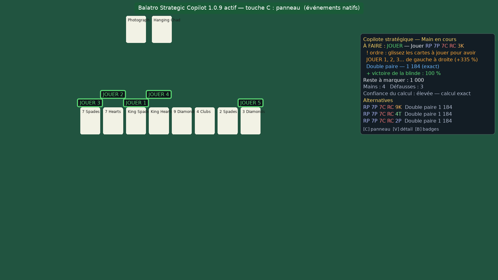

# Balatro Strategic Copilot

Mod Steamodded pour **Balatro** qui agit comme un copilote stratégique : il lit l'état de la
partie, calcule les scores exacts, les probabilités, évalue la boutique, conseille mains et
défausses, et **apprend de vos parties**. **Il ne joue jamais à votre place** : il n'effectue
aucune action (sélection, jeu, défausse, achat, vente, relance).

> Statut : version 1.0.11. Développée **hors du jeu** (aucune installation de Balatro n'était
> disponible dans l'environnement de développement), puis essayée par l'utilisateur dans le vrai
> jeu (mode copier-coller). Validée par des tests automatisés, un environnement Balatro/Steamodded
> simulé, le vrai runtime LÖVE 11.5 et des parties complètes simulées ([entraînement](docs/TRAINING.md)).
> Voir [Limites](docs/LIMITATIONS.md) et [Tests](docs/TESTS.md).


## Fonctionnalités

| Domaine | Ce que fait le copilote |
|---|---|
| Mains | Évalue les 218 combinaisons jouables (≤ 5 cartes parmi 8), score **exact** quand tout est déterministe, distribution énumérée des aléas (Lucky, Misprint, Bloodstone, Space Joker…), probabilité de réussite immédiate ; chaque main est évaluée **dans son meilleur ordre** et l'**ordre des cartes** est affiché (JOUER 1, 2, 3…, GARDER 1, 2…) quand il change le score (Photograph, Hanging Chad, verre, polychrome, Baron + Shoot the Moon) |
| Défausses | Cibles (couleur, suite, brelan, full…) avec **probabilité exacte** de complétion sur la composition connue du deck |
| Manche | Probabilité de battre la blinde pour chaque action candidate, par simulation de la fin de manche avec une politique explicite |
| Sélection | Score exact des cartes que **vous** sélectionnez, en direct, contrôlé par l'identification de main du jeu |
| Boutique | Note stratégique /100, effet mesuré sur la prochaine blinde et le boss, coûts et intérêts perdus, ventes, remplacements, intérêt d'une relance (pool réel de jokers) |
| Synergies | Contribution **mesurée** de chaque joker, ordre optimal des jokers, et les **builds des meilleurs joueurs** (Baron + Mime, Photograph + Hanging Chad, Triboulet, Canio, couleur, verre, acier…) : synergies et anti-synergies en boutique, pièces à chercher, cibles des tarots selon le build |
| Blindes | Prochaine blinde et boss simulés avec leurs effets (malus de couleur, The Needle, The Water, The Psychic, Cerulean Bell…), **passage d'une blinde** calculé tag par tag contre son coût réel (récompense, mains, intérêts, boutique) |
| Risque | Pondérations qui dépendent continûment du danger (survie quand la situation est critique, investissement quand elle est confortable) |
| Effets | Améliorations, éditions, sceaux et autocollants des jokers affichés et pris en compte (garder l'acier et l'or en main, défausser le sceau violet, jamais vendre un éternel…) |
| Plan de partie | Leçons des meilleurs joueurs ([sources](docs/PRO_LESSONS.md)) : main principale, ×Mult attendus par ante, argent au-delà des intérêts réinvesti, boss à préparer |
| Apprentissage | Journal local des parties, calibration validée des probabilités, croissance de puissance, contributions des jokers, bilan après chaque partie qui cherche **pourquoi** le build n'a pas suffi (jamais « malchance ») ; après chaque défaite, le copilote **essaie un changement** de son développement (urgence des ×Mult, achats, épargne, sécurité, passages) selon la cause qui revient dans vos défaites, et ne le **garde que si les parties suivantes ne sont pas moins bonnes** ; chaque étape est expliquée dans le bilan |
| Mises et decks | Mises 1 à 8 lues dans le jeu (Small Blind sans récompense, blindes plus grosses, autocollants éternel / périssable / **location** comptée sur toute sa durée, une défausse de moins) : ×Mult attendus plus tôt aux mises verte et violette, joker loué revendu dès qu'il n'est plus nécessaire ; decks de départ pris en compte via l'état réel (cartes, bons, consommables). **1.0.10** : règles des meilleurs joueurs à partir de la mise verte (presque jamais passer une blinde, pas d'épargne sans ×Mult à l'ante 4 ni sans plateau vraiment sûr, une seule location), mesurées sur le simulateur ([résultats](docs/TRAINING.md)) |
| Compatibilité | Détection des mods, éléments inconnus signalés comme « partiel », contrôle croisé avec le jeu, dégradation contrôlée |

## Installation rapide (Windows)

**Méthode sans programme (recommandée, 1.0.4+)** — ni Lovely, ni Steamodded, ni script, ni DLL ;
fonctionne aussi sur un PC protégé (contrôle parental, antivirus strict) :

1. Extraire l'archive `BalatroStrategicCopilot-1.0.11.zip`.
2. Copier le **contenu** du dossier `COPIER_DANS_AppData_Balatro` (`main.lua` + `Mods`) dans
   `%AppData%\Balatro\` (touche Windows + R, `%AppData%\Balatro`).
3. Lancer Balatro : bandeau vert « … actif — touche C : panneau (mode autonome, sans Steamodded) ».

Balatro tourne sur LÖVE 11, qui lit `main.lua` d'abord dans le dossier de sauvegarde : le
`main.lua` fourni exécute celui du jeu, inchangé, puis démarre le copilote (détails et limites :
[docs/INSTALL.md](docs/INSTALL.md)). Désinstaller : supprimer `%AppData%\Balatro\main.lua`.

**Avec Lovely + Steamodded** : copier le dossier `BalatroStrategicCopilot` dans
`%AppData%\Balatro\Mods\` (de sorte que `Mods\BalatroStrategicCopilot\BalatroStrategicCopilot.json`
existe ; une archive `.zip` déposée telle quelle est ignorée par les anciens Steamodded). L'archive
`BalatroStrategicCopilot-1.0.11-installateur.zip` contient `INSTALLER_COPILOT.bat`, qui vérifie et
répare toute la chaîne (dossier du jeu, Lovely, Steamodded, copilote) puis confirme que tout s'est
chargé. Un **bandeau vert « actif »** s'affiche au lancement ; **aucun bandeau = mod non trouvé**
([pièges vérifiés](docs/INSTALL.md)).

Désinstallation : supprimer `%AppData%\Balatro\main.lua` (mode autonome) et
`%AppData%\Balatro\Mods\BalatroStrategicCopilot` (et, si souhaité,
les données apprises `%AppData%\Balatro\BSC\`). Détails dans [docs/INSTALL.md](docs/INSTALL.md).

## Utilisation

| Touche (configurable) | Action |
|---|---|
| `C` | ouvrir / fermer le panneau stratégique |
| `V` | afficher / masquer les alternatives et les détails |
| `B` | afficher / masquer les badges sur les cartes |

### Une étape à la fois (« À FAIRE »)

Le copilote indique **une seule action à faire maintenant**, avec une étiquette au-dessus de ce
qu'il faut toucher ; dès que vous l'avez faite, il recalcule et montre la suivante :

| Étiquette | Où | Quand |
|---|---|---|
| **JOUER** / **DÉFAUSSER** | sur les cartes de la main | la meilleure action de la manche (aussi avec des cartes face cachée, ex. boss The House) ; **IMPOSÉE** sur la carte que Cerulean Bell sélectionne d'office (elle part avec le jeu ou la défausse) |
| **JOUER 1, 2, 3…** / **GARDER 1, 2…** | sur les cartes de la main | quand l'ordre des cartes change le score : glissez les cartes jouées (et les cartes gardées en main) dans l'ordre des numéros, de gauche à droite ; le gain est écrit dans le panneau |
| **À PRENDRE** | sur l'objet de boutique ou la carte du paquet | le meilleur achat rentable (avec sa note /100) |
| **À VENDRE** | sur un joker ou un consommable | pour remplacer un joker par un meilleur, faire de la place, gagner de l'argent avec un joker inutile, ou un effet de vente (Luchador contre un boss dangereux, Invisible Joker prêt) |
| **RELANCER** | sur le bouton de relance | relance gratuite, meilleure boutique assez probable, ou une relance avant de partir (habitude des meilleurs joueurs), sans casser l'épargne des intérêts |
| **BLINDE SUIVANTE** | sur le bouton pour quitter la boutique | quand plus rien n'est rentable, ou pour garder 25 $ d'intérêts (à partir de l'ante 2, si la suite est sûre) |
| **JOUER** / **PASSER** | sur les boutons du choix de blinde | passer quand le tag vaut plus que ce que coûte le passage (récompense, mains, intérêts, boutique) et que la blinde suivante reste sûre sans boutique ; détail affiché dans le panneau ; seul le choix définitif s'affiche |
| **UTILISER** + **CIBLE** | sur un consommable (+ les cartes à sélectionner) | planètes, argent (Hermit, Temperance), tarots et spectrales sur les cartes visées ; **Death** : DEVIENT (gauche) et MODÈLE (droite), avec la consigne de glisser la carte à gauche si besoin ; Hanged Man : À DÉTRUIRE |
| **PASSER** | sur le bouton du paquet | quand aucune carte du paquet n'améliore le jeu |
| **1, 2, 3…** | sous les jokers | seulement quand l'ordre actuel n'est pas le bon (un ×Mult avant un +Mult) : glissez les jokers pour suivre les numéros |

Le panneau se place sous la zone des consommables pour ne pas cacher l'étiquette UTILISER. Les
achats suivent une discipline inspirée des meilleurs joueurs (paquets souvent achetés, intérêts
préservés, une relance avant de quitter la boutique, blindes passées pour les bons tags) ; seuils
réglables dans `config.lua`, section `advice` (détails : [docs/MATHS.md](docs/MATHS.md) §7–8).

La ligne « À FAIRE » est aussi la première du résumé compact, avec la probabilité qui justifie le
choix (visible par défaut ; `V` masque les détails et alternatives). Si l'étiquette d'un bouton
n'apparaît pas, l'étape reste écrite dans le résumé (voir [docs/LIMITATIONS.md](docs/LIMITATIONS.md)).

Panneau fermé, un résumé compact reste visible. Au menu principal, `C` affiche l'**historique** :
dernier bilan de partie, taux de victoire avec intervalle, calibration et précision des scores.
Les options (badges, alertes, apprentissage, export, import, réinitialisation) sont dans
*Mods → Balatro Strategic Copilot → Config*.

### Lire les indicateurs

* **Probabilité** (`Victoire blinde : 87 %`) : probabilité estimée d'atteindre un objectif
  défini, toujours accompagnée de sa **méthode** (calcul exact, énumération, simulation n=…)
  et d'un **niveau de confiance**. Une simulation n'affiche jamais « 100 % » mais sa borne
  (`≥ 94 %`).
* **Note stratégique** (`82/100`) : sert à **comparer** des options, ce n'est **pas** une
  probabilité.
* **Couleurs** vert / orange / rouge toujours doublées d'un symbole (`+` `~` `-`) pour les
  joueurs qui distinguent mal les couleurs.
* `≈` et « partiel » : un élément (joker moddé, carte cachée…) n'a pas pu être analysé.

Explications détaillées : [docs/PERCENTAGES.md](docs/PERCENTAGES.md).













*Captures produites avec le vrai runtime LÖVE 11.5 sur un état de jeu simulé (cartes factices) :
elles montrent le rendu du mod, pas l'apparence du jeu.*

## Documentation

* [Audit de l'environnement](docs/AUDIT.md) — ce qui a été vérifié, et comment
* [Architecture et cahier des charges](docs/ARCHITECTURE.md)
* [Description des modules](docs/MODULES.md)
* [Installation / désinstallation / mise à jour](docs/INSTALL.md)
* [Pourcentages et notes affichés](docs/PERCENTAGES.md)
* [Méthodes mathématiques et limites des estimations](docs/MATHS.md)
* [Leçons des meilleurs joueurs appliquées](docs/PRO_LESSONS.md) (recherches sourcées : [générale](docs/PRO_LESSONS_SOURCES.md), [blindes passées](docs/PRO_SKIPS_SOURCES.md), [synergies des builds](docs/PRO_SYNERGIES_SOURCES.md))
* [Entraînement sur des parties simulées](docs/TRAINING.md)
* [Système d'apprentissage, export, réinitialisation](docs/LEARNING.md)
* [Tests et résultats](docs/TESTS.md)
* [Limites connues](docs/LIMITATIONS.md)
* [Dépannage](docs/TROUBLESHOOTING.md)
* [Historique des versions](CHANGELOG.md)

## Dépendances

| Composant | Version | Rôle |
|---|---|---|
| Balatro | 1.0.1 (série 1.0.1x, lue via `G.VERSION`) | jeu |
| Lovely | ≥ 0.9.0 (dépendance de Steamodded) | injecteur |
| Steamodded | ≥ `1.0.0~BETA-0301a` déclaré ; API vérifiées sur `26.1002.0` et `1.0.0~BETA-0509c` (mai 2025, sans événements de mod : détection par état) | chargeur de mods |

Aucune autre dépendance, aucune connexion réseau, aucune télémétrie. Le mod n'utilise
**aucun patch Lovely** et ne modifie aucun fichier du jeu ni ses sauvegardes.

## Développement

```bash
luajit tests/run.lua            # suite complète (LuaJIT, comme le jeu)
lua5.1 tests/run.lua            # même suite sous Lua 5.1
luajit tests/run.lua score      # filtre par nom de fichier
python3 tools/build.py          # paquet dist/BalatroStrategicCopilot-<version>.zip
luajit tools/smods_loader_check.lua <sources_steamodded> <dossier_Mods>  # vrai chargeur Steamodded
pwsh -File tests/installer/test_installer.ps1 -Zip dist/BalatroStrategicCopilot-<version>-installateur.zip
tests/standalone/run_love_standalone.sh dist/BalatroStrategicCopilot-<version>.zip   # mode autonome, vrai LÖVE
xvfb-run -s "-screen 0 1600x900x24" love tools/love_harness "$(pwd)" hand   # rendu réel LÖVE
```
