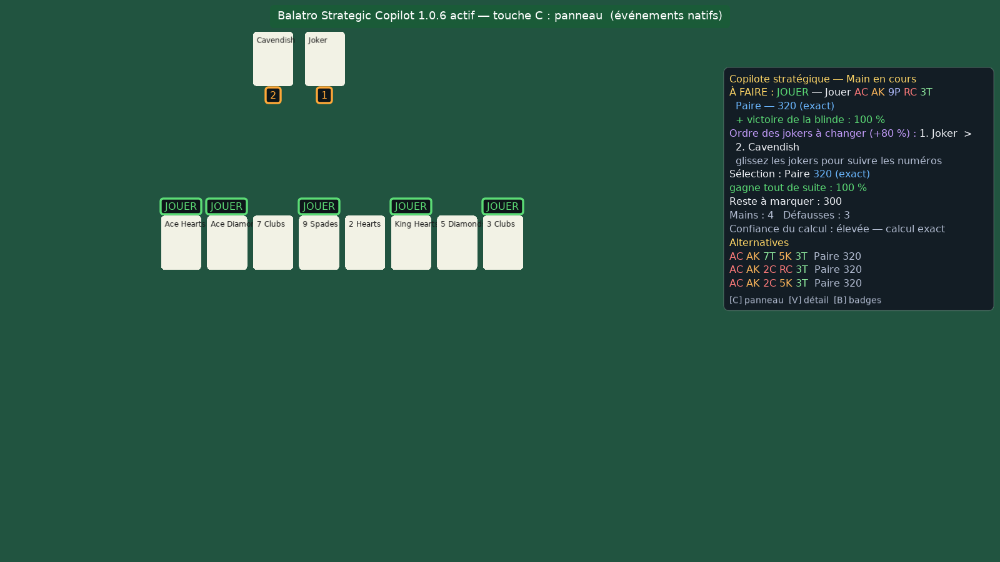
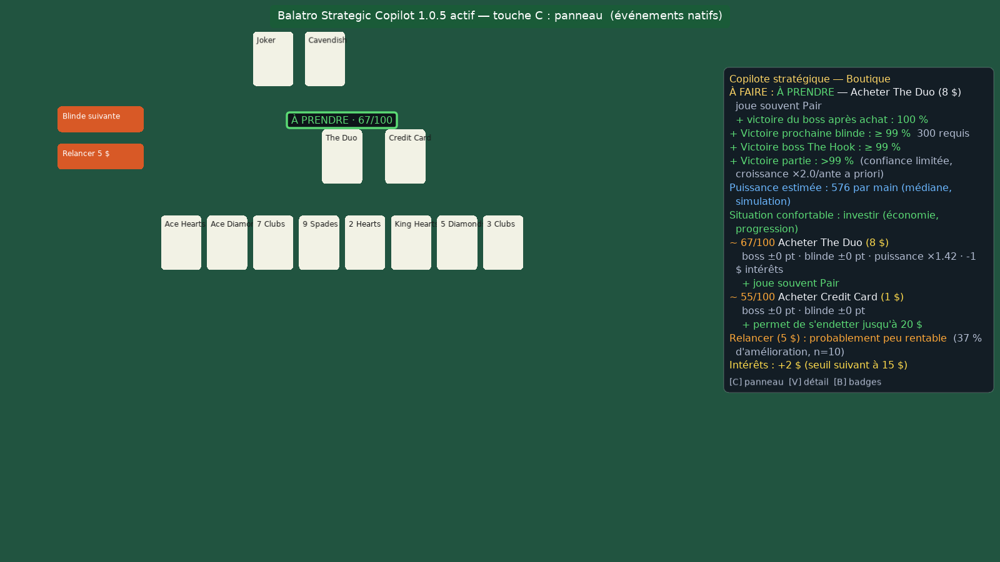
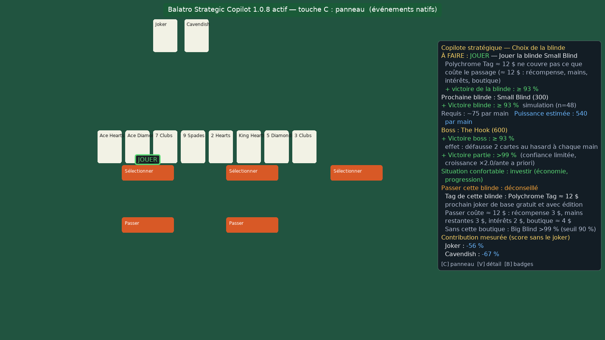

# Balatro Strategic Copilot

Mod Steamodded pour **Balatro** qui agit comme un copilote stratégique : il lit l'état de la
partie, calcule les scores exacts, les probabilités, évalue la boutique, conseille mains et
défausses, et **apprend de vos parties**. **Il ne joue jamais à votre place** : il n'effectue
aucune action (sélection, jeu, défausse, achat, vente, relance).

> Statut : version 1.0.0. Développée et testée **hors du jeu** (aucune installation de Balatro
> n'était disponible dans l'environnement de développement). Le code a été validé par
> 174 tests automatisés, un environnement Balatro/Steamodded simulé et le vrai runtime LÖVE 11.5,
> mais **pas encore dans Balatro réel**. Voir [Limites](docs/LIMITATIONS.md) et [Tests](docs/TESTS.md).



## Fonctionnalités

| Domaine | Ce que fait le copilote |
|---|---|
| Mains | Évalue les 218 combinaisons jouables (≤ 5 cartes parmi 8), score **exact** quand tout est déterministe, distribution énumérée des aléas (Lucky, Misprint, Bloodstone, Space Joker…), probabilité de réussite immédiate |
| Défausses | Cibles (couleur, suite, brelan, full…) avec **probabilité exacte** de complétion sur la composition connue du deck |
| Manche | Probabilité de battre la blinde pour chaque action candidate, par simulation de la fin de manche avec une politique explicite |
| Sélection | Score exact des cartes que **vous** sélectionnez, en direct, contrôlé par l'identification de main du jeu |
| Boutique | Note stratégique /100, effet mesuré sur la prochaine blinde et le boss, coûts et intérêts perdus, ventes, remplacements, intérêt d'une relance (pool réel de jokers) |
| Synergies | Contribution **mesurée** de chaque joker, ordre optimal des jokers, adéquation d'un joker au build |
| Blindes | Prochaine blinde et boss simulés avec leurs effets (malus de couleur, The Needle, The Water, The Psychic…), conseil pour passer une blinde |
| Risque | Pondérations qui dépendent continûment du danger (survie quand la situation est critique, investissement quand elle est confortable) |
| Apprentissage | Journal local des parties, calibration validée des probabilités, croissance de puissance, contributions des jokers, bilan après chaque partie |
| Compatibilité | Détection des mods, éléments inconnus signalés comme « partiel », contrôle croisé avec le jeu, dégradation contrôlée |

## Installation rapide (Windows)

1. Installer [Lovely](https://github.com/ethangreen-dev/lovely-injector) et
   [Steamodded](https://github.com/Steamodded/smods) (voir [docs/INSTALL.md](docs/INSTALL.md)).
2. Copier le dossier `BalatroStrategicCopilot/` dans `%AppData%\Balatro\Mods\`
   (ou utiliser l'archive `dist/BalatroStrategicCopilot-1.0.1.zip` produite par `python tools/build.py`).
3. Lancer Balatro. Un **bandeau vert « actif »** s'affiche quelques secondes en haut de l'écran
   (ou un bandeau rouge expliquant l'erreur). Les conseils apparaissent **en partie**.

Désinstallation : supprimer `%AppData%\Balatro\Mods\BalatroStrategicCopilot` (et, si souhaité,
les données apprises `%AppData%\Balatro\BSC\`). Détails dans [docs/INSTALL.md](docs/INSTALL.md).

## Utilisation

| Touche (configurable) | Action |
|---|---|
| `C` | ouvrir / fermer le panneau stratégique |
| `V` | afficher / masquer les alternatives et les détails |
| `B` | afficher / masquer les badges sur les cartes |

Panneau fermé, un résumé compact reste visible. Au menu principal, `C` affiche l'**historique** :
dernier bilan de partie, taux de victoire avec intervalle, calibration et précision des scores.
Les options (badges, alertes, apprentissage, export, import, réinitialisation) sont dans
*Mods → Balatro Strategic Copilot → Config*.

### Lire les indicateurs

* **Probabilité** (`Victoire blinde : 87 %`) : probabilité estimée d'atteindre un objectif
  défini, toujours accompagnée de sa **méthode** (calcul exact, énumération, simulation n=…)
  et d'un **niveau de confiance**. Une simulation n'affiche jamais « 100 % » mais sa borne
  (`≥ 94 %`).
* **Note stratégique** (`82/100`) : sert à **comparer** des options, ce n'est **pas** une
  probabilité.
* **Couleurs** vert / orange / rouge toujours doublées d'un symbole (`+` `~` `-`) pour les
  joueurs qui distinguent mal les couleurs.
* `≈` et « partiel » : un élément (joker moddé, carte cachée…) n'a pas pu être analysé.

Explications détaillées : [docs/PERCENTAGES.md](docs/PERCENTAGES.md).





*Captures produites avec le vrai runtime LÖVE 11.5 sur un état de jeu simulé (cartes factices) :
elles montrent le rendu du mod, pas l'apparence du jeu.*

## Documentation

* [Audit de l'environnement](docs/AUDIT.md) — ce qui a été vérifié, et comment
* [Architecture et cahier des charges](docs/ARCHITECTURE.md)
* [Description des modules](docs/MODULES.md)
* [Installation / désinstallation / mise à jour](docs/INSTALL.md)
* [Pourcentages et notes affichés](docs/PERCENTAGES.md)
* [Méthodes mathématiques et limites des estimations](docs/MATHS.md)
* [Système d'apprentissage, export, réinitialisation](docs/LEARNING.md)
* [Tests et résultats](docs/TESTS.md)
* [Limites connues](docs/LIMITATIONS.md)
* [Dépannage](docs/TROUBLESHOOTING.md)
* [Historique des versions](CHANGELOG.md)

## Dépendances

| Composant | Version | Rôle |
|---|---|---|
| Balatro | 1.0.1 (série 1.0.1x, lue via `G.VERSION`) | jeu |
| Lovely | ≥ 0.9.0 (dépendance de Steamodded) | injecteur |
| Steamodded | ≥ `1.0.0~BETA-0301a` déclaré ; API vérifiées sur `26.1002.0` et `1.0.0~BETA-0509c` (mai 2025, sans événements de mod : détection par état) | chargeur de mods |

Aucune autre dépendance, aucune connexion réseau, aucune télémétrie. Le mod n'utilise
**aucun patch Lovely** et ne modifie aucun fichier du jeu ni ses sauvegardes.

## Développement

```bash
luajit tests/run.lua            # suite complète (LuaJIT, comme le jeu)
lua5.1 tests/run.lua            # même suite sous Lua 5.1
luajit tests/run.lua score      # filtre par nom de fichier
python3 tools/build.py          # paquet dist/BalatroStrategicCopilot-<version>.zip
xvfb-run -s "-screen 0 1600x900x24" love tools/love_harness "$(pwd)" hand   # rendu réel LÖVE
```
